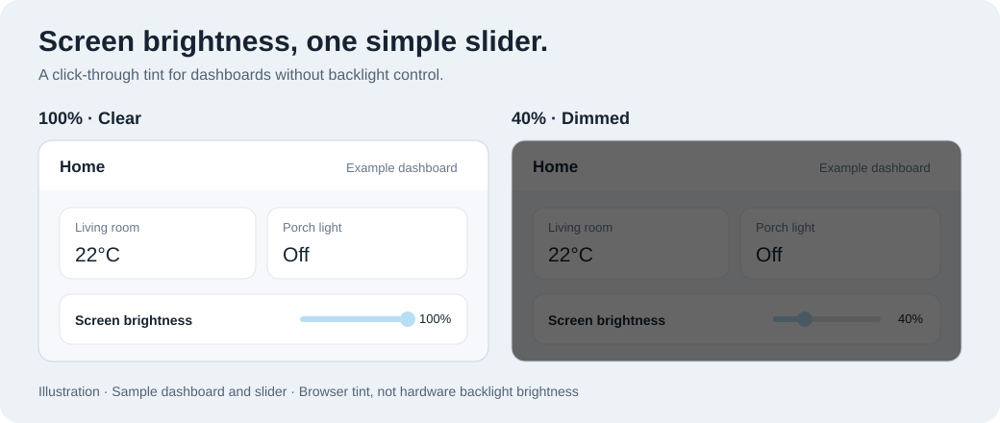

# Screen Dimmer

Dim a Home Assistant kiosk screen with a smooth, click-through tint and a simple slider. Useful when your display cannot expose its backlight controls.



*Illustration of the slider and tint effect, not a Home Assistant screenshot. Card styling varies by dashboard and browser.*

## Quick start

Requires **Home Assistant 2025.3.0 or later**.

1. In HACS, add `https://github.com/bradleyseanf/ha-kiosk-screen-dimmer` as a **custom repository → Integration**, then install **Screen Dimmer**. Default HACS catalog inclusion is pending.
2. Restart Home Assistant, then add **Screen Dimmer** under **Settings → Devices & services → Add integration**.
3. Under **Settings → Dashboards → Resources**, add `/ha_kiosk_screen_dimmer/brightness-dimmer.js?v=0.1.0` as a **JavaScript module**. Enable Advanced Mode in your profile if Resources is hidden.
4. Add a **Manual** dashboard card:

```yaml
type: custom:screen-dimmer-slider
entity: light.ha_kiosk_screen_dimmer
mode: brightness
name: Screen brightness
```

Use the entity ID created by your integration if it differs. The slider includes the overlay, so no extra card is needed.

Without HACS, copy `custom_components/ha_kiosk_screen_dimmer` into your Home Assistant `config/custom_components` directory, then follow steps 2–4. No separate `www` copy is needed.

## How it works

- Drag for an immediate preview. The virtual light saves the setting for automations and other controls.
- In the example above, **100% is clear** and **15% is the darkest default setting**. Omit `mode: brightness` to control tint strength instead.
- The overlay stays click-through and follows you between views in that dashboard. Use one dimmer configuration per browser tab.
- This changes the browser tint, **not the hardware backlight**. The default maximum tint is 85%; the safety cap is 95%.

[More options and overlay-only setup](docs/configuration.md) · [Changelog](https://github.com/bradleyseanf/ha-kiosk-screen-dimmer/releases) · [Development](docs/development.md)

## Need help?

[Report a bug or request a feature](https://github.com/bradleyseanf/ha-kiosk-screen-dimmer/issues). Include your Home Assistant and Screen Dimmer versions, browser/device, card YAML, and steps to reproduce. Remove private details from logs and screenshots.
